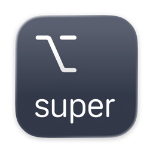

<h1>
    
    SuperOpt
</h1>

[](https://github.com/logonoff/superopt/releases/latest)
[](http://www.wtfpl.net/)

> [!WARNING]
> Much of this code was written with AI assistance and has not been thoroughly reviewed. Use at your own risk.

A macOS menu bar app that brings GNOME desktop muscle memory to the Mac. Requires macOS 27 Golden Gate or later.

## Install

```
brew install --cask logonoff/bucket/superopt
```

Or build from source:

```
make install
```

### Gatekeeper

This app is self-signed but not notarized, so macOS may block it the first time you try to open it. If it does, open System Settings, click Privacy & Security, scroll down, and click Open Anyway. Or remove the quarantine attribute before opening it:

```
xattr -d com.apple.quarantine /Applications/SuperOpt.app
```

### Verification

Releases are signed with a self-signed certificate (RSA-2048; CN=SuperOpt) but not notarized (notarization requires a paid Apple Developer Program membership). For additional assurance:

- **[Build attestations](https://github.com/logonoff/superopt/attestations)**: Every release ZIP file has a GitHub build provenance attestation linking the artifact to the exact source commit and workflow run, so you can confirm that the binary was built from the published source code and hasn’t been tampered with since. Verify with `gh attestation verify SuperOpt.zip --repo logonoff/superopt`.
- **[Immutable releases](https://docs.github.com/en/code-security/concepts/supply-chain-security/immutable-releases)**: Release tags are never moved, and release assets are never replaced. The Homebrew cask pins a SHA-256 hash.
- **Signed commits**: All commits to `main` are GPG-signed.

The code-signing public key is available at [`codesign.pem`](https://logonoff.github.io/superopt/codesign.pem) (RSA-2048; SHA-256 of the file: `4fbb60bb36dee64f110fba20aa10b6e8092ef844390b5151228487bdbebbc86d`).

## Features

Features are on by default unless noted otherwise.

### Option key shortcuts

| Shortcut | Action |
|---|---|
| ⌥ | Enter or leave Mission Control |
| ⌥ twice | Show or hide the apps window in Spotlight |
| ⌥A | Show or hide the apps window in Spotlight |
| ⌥1–9 | Open the app at that position in the Dock |

### Desktop

| Feature | Description |
|---|---|
| Hot corner | Quickly moving the pointer to the top-left corner of any screen opens Mission Control (with a GNOME-style ripple animation) |
| Window tiling | The Option-Arrow keys tile, fill, or restore windows (off by default) |
| Green button fills the screen | Clicking the green button expands the window to fill the screen instead of entering full screen (off by default) |
| Close windows in Mission Control | A close button appears when you hold the pointer over a window in Mission Control |
| Type to search in Mission Control | Typing in Mission Control closes it and sends what you typed to Spotlight or the apps window (off by default) |
| Tile assist | When you tile a window to the left or right, SuperOpt suggests windows to fill the other half (off by default) |
| Dark menu bar | A black bar appears behind the menu bar when a window fills the screen (off by default) |
| Scroll to switch spaces | Scrolling over a display’s Apple menu switches that display to the next or previous space (off by default) |
| Dynamic Spaces | While you’re in Mission Control, SuperOpt keeps one desktop empty and removes other empty desktops (off by default) |
| Space indicator | An onscreen row of dots appears when a display switches spaces (off by default) |

### Keyboard

| Feature | Description |
|---|---|
| Caps Lock indicator | An onscreen indicator appears when you turn Caps Lock on or off |
| Home and End | The Home and End keys move the insertion point to the beginning or end of the line in text fields; Control-Home and Control-End move it to the beginning or end of the document |
| Menu key → shortcut menu | The Menu key on Windows keyboards opens a shortcut menu (off by default) |
| Remap Linux shortcuts | SuperOpt maps Linux keyboard shortcuts to their Mac equivalents: Control-C, Control-X, and Control-V; Alt-F4; F2 to rename in the Finder; browser, terminal, and code editor shortcuts; and more (off by default) |

### Input

| Feature | Description |
|---|---|
| Scroll to zoom in browsers | In web browsers, Control-scroll zooms in and out, with a choice of Natural or Traditional scroll direction (off by default) |
| Click-through focus | Clicking an inactive window brings it to the front and passes the click through, as on Windows or Linux (off by default) |
| Cut and paste files in the Finder | Cut, then paste in the Finder to move files: Press Command-X, then Command-V (or Control-X, then Control-V), depending on which pair you choose in SuperOpt settings (off by default) |
| Middle-click paste | Middle-clicking pastes in text fields (X11-style), opens a new window when you middle-click an app icon in the Dock, or behaves as it normally does elsewhere (off by default) |

You can turn each feature on or off in SuperOpt settings, which you open by clicking the SuperOpt icon in the menu bar and choosing Settings. SuperOpt detects the Option key when you release it, so existing shortcuts are unaffected.

While you’re using an app in the Excluded Apps list, SuperOpt turns off every feature and dims its own menu bar icon, so the app behaves as it would without SuperOpt. Excluded Apps is off by default.

## Build

```
./build.sh
```

Requires Command Line Tools for Xcode (`xcode-select --install`).

## Permissions

SuperOpt requires two permissions in Privacy & Security settings:

- **Device Control and Data Access**: sending keystrokes and controlling windows
- **Input Monitoring**: monitoring keyboard and mouse input in any app

Use the Request Permissions menu item to check for missing permissions and open the relevant settings pane.

## Privacy

SuperOpt runs entirely offline. It doesn’t collect usage data, connect to the internet, or send any information. All processing happens on your Mac. You can review the source code in this repository.

## License

[WTFPL v2](http://www.wtfpl.net/)

This program is free software. It comes without any warranty, to the extent permitted by applicable law.
